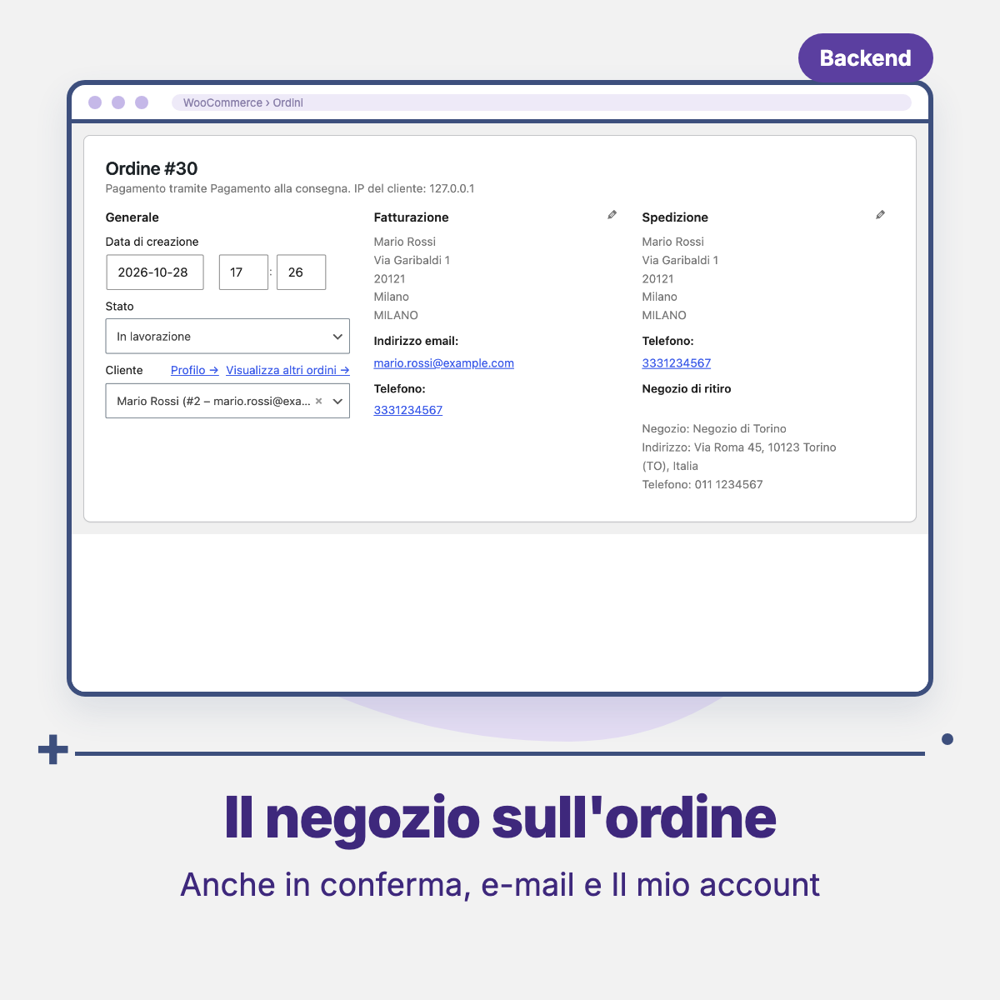

# Threecommerce Store Pickup: pickup in store for WooCommerce

A WooCommerce shipping method, **Pickup in store**: at checkout the customer chooses the pickup store from a **list** or a **map**. The chosen store is saved with the order and shown in the admin, the confirmation page, the order emails and My Account. It is an add-on of [Threecommerce Store Locator](https://github.com/Threecommerce/woocommerce-store-locator) and the WooCommerce port of our Magento 2 store pickup module.

**Compatibility:** WordPress 6.0+ (tested on 7.1) · WooCommerce 8.0+ (tested on 10.9.4) · PHP 8.1 – 8.4 · Block-based and classic checkout · HPOS
**License:** commercial · coming soon

## Features

- **Shipping method** `Pickup in store` to add to your shipping zones: title, cost (empty or 0 = free), tax status and allowed countries. It is not offered when no store is enabled for pickup.
- **Pickup flag per store**, added to the store screen of Threecommerce Store Locator (which is not modified), with a column in the store list. Only active stores with the flag are offered at checkout.
- **Store choice at checkout** from a list or a map (OpenStreetMap or Google Maps, the same setting as the store locator), shown only when the pickup method is selected, for both the **classic checkout** and the **block-based checkout**.
- **Server-side validation** in both flows: an order with pickup and no valid store cannot be placed, even without JavaScript.
- The chosen store (id, name, address, phone) is saved as an order snapshot (HPOS compatible) and shown in the order admin page, the confirmation page, the order emails and My Account.
- The shipping address of the order is not replaced with the store address: the store is a separate block.
- Italian translation included.

## Requirements

- WordPress 6.0 or newer
- PHP 8.1 – 8.4
- WooCommerce 8.0 or newer
- [Threecommerce Store Locator](https://github.com/Threecommerce/woocommerce-store-locator) 1.x. Without it the plugin activates but stays inactive (no shipping method, no choice at checkout) and shows an admin notice
- Map: OpenStreetMap needs nothing; Google Maps needs the key set in the store locator (without a key the list is shown)

## Tested with

WordPress 7.1 and WooCommerce 10.9.4, with the classic and the block-based checkout and the order emails. Google Maps with a real API key has **not** been tested yet.

## Availability

This plugin is **not yet available for purchase**. See the [product page](https://www.threecommerce.it/ritiro-in-negozio-woocommerce?utm_source=github&utm_medium=readme&utm_campaign=woocommerce-store-pickup) for its status, or [get in touch](https://www.threecommerce.it/contatti?utm_source=github&utm_medium=readme&utm_campaign=woocommerce-store-pickup) to be notified at launch or to ask for information.

## Configuration

1. **Stores enabled for pickup**: *Store Locator → Stores*, edit a store and turn on *Available for pickup*.
2. **Shipping method**: *WooCommerce → Settings → Shipping*, choose a zone, *Add shipping method → Pickup in store* (title, cost, tax status, countries).
3. **Map**: uses the provider, key and zoom of *Store Locator → Settings*.

## Documentation and support

- Product page: [threecommerce.it/ritiro-in-negozio-woocommerce](https://www.threecommerce.it/ritiro-in-negozio-woocommerce?utm_source=github&utm_medium=readme&utm_campaign=woocommerce-store-pickup)
- [Changelog](CHANGELOG.md) (in Italian)
- Support and custom development: [threecommerce.it/contatti](https://www.threecommerce.it/contatti?utm_source=github&utm_medium=readme&utm_campaign=woocommerce-store-pickup)

---

*This repository is the public showcase of the plugin. The source code is kept in a private repository.*
